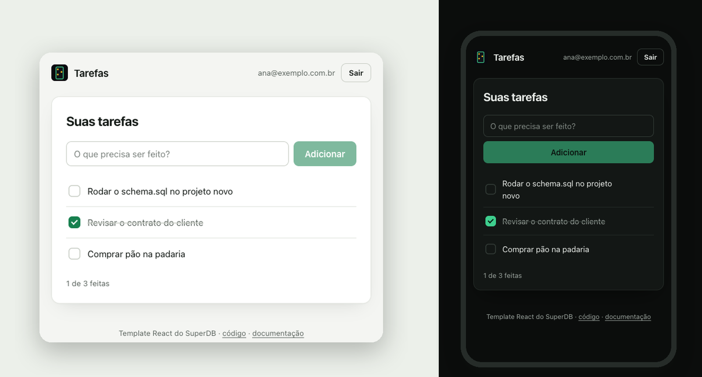
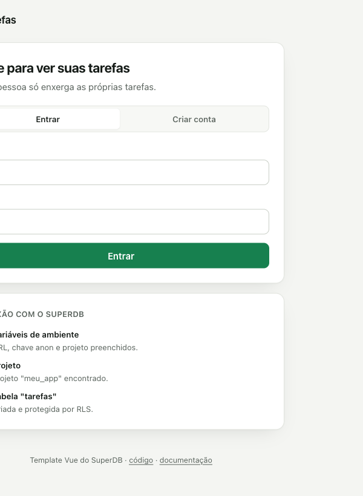
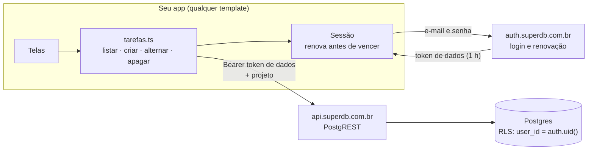

# Templates do SuperDB

**O mesmo app em 7 stacks: login, sessão que se renova sozinha e uma lista de tarefas em que cada pessoa só enxerga as próprias. Copie, ligue ao seu projeto e rode.**

---

## Escolha o seu

| | Template | Quando usar | A sessão fica em | Comece com |
|:-:|---|---|---|---|
| ▲ | **[Next.js](./nextjs)** | Site ou app com SSR, SEO e Server Actions | cookies httpOnly | `npx create-next-app@latest meu-app --example https://github.com/superdb-br/templates/tree/main/nextjs` |
| ⚛ | **[React](./react)** | Painel, SPA, app que roda só no navegador | localStorage | `npx degit superdb-br/templates/react meu-app` |
| ▼ | **[Vue](./vue)** | SPA com Vue 3 e Vite | localStorage | `npx degit superdb-br/templates/vue meu-app` |
| ◆ | **[SvelteKit](./sveltekit)** | SPA estática com Svelte 5 | localStorage | `npx degit superdb-br/templates/sveltekit meu-app` |
| ◉ | **[Nuxt](./nuxt)** | SPA com Nuxt 4 | localStorage | `npx degit superdb-br/templates/nuxt meu-app` |
| ⌗ | **[HTML puro](./html)** | Protótipo, landing, sem npm e sem build | localStorage | `npx degit superdb-br/templates/html meu-app` |
| ▣ | **[Expo](./expo)** | App de celular (iOS e Android) | AsyncStorage | `npx degit superdb-br/templates/expo meu-app` |

> [!TIP]
> Não sabe qual? **Next.js** se o app precisa aparecer no Google ou buscar dados no servidor; **React** se é um painel atrás de login; **Expo** se é para o celular.

## Três passos, em qualquer um deles

**1. Copie o template** com o comando da tabela acima e entre na pasta (`cd meu-app`, depois `npm install`).

**2. Ligue ao seu projeto.** No [painel do SuperDB](https://app.superdb.com.br), abra o projeto e clique em **Conectar**. Copie a URL, a chave anon e o slug do projeto para o `.env` (cada template traz um `.env.example` com os nomes certos).

**3. Crie a tabela.** Ainda no painel, abra o **SQL Editor**, cole o arquivo [`superdb/schema.sql`](./react/superdb/schema.sql) e rode. É o mesmo arquivo em todos os templates.

Pronto: `npm run dev`, crie uma conta na tela do app e comece a usar.

> [!NOTE]
> Sem projeto ainda? [Crie um de graça](https://app.superdb.com.br/signup). A tela inicial de cada template confere a ligação e diz exatamente o que falta: variável, projeto ou tabela.

## O que todos têm em comum

- **Login e cadastro** com e-mail e senha, e mensagens de erro em português ("E-mail ou senha incorretos.", não `invalid_credentials`).
- **Sessão que se renova sozinha.** O token do SuperDB vale 1 hora; o template renova antes de vencer, no instante em que uma consulta precisa dele.
- **Duas abas não derrubam o login.** O SuperDB troca o refresh token a cada renovação e trata reuso como roubo. Os templates renovam uma vez só, mesmo com várias abas abertas ou várias requisições ao mesmo tempo.
- **Dados protegidos no banco, não no app.** A regra de RLS do `schema.sql` faz cada pessoa ver, alterar e apagar só as próprias tarefas. O app nunca manda `user_id`, e não adianta forjar um.
- **Tela que diz o que falta configurar**, em vez de um erro solto no console.
- **O mesmo visual** em todos (tema claro e escuro, celular e desktop), numa folha de estilo que você troca num lugar só.
- **Instruções para IA.** Cada template traz um `AGENTS.md` (lido pelo Claude Code, Cursor, Codex e outros) com as regras que evitam os erros mais comuns.

## Como funciona, em uma figura

O login devolve dois tokens: o **access token**, para falar com o auth, e o **token de dados** (`data_plane_token`), que é o que a API de dados aceita. O SDK escolhe o certo sozinho; se você for chamar a API na mão, é o token de dados que vai no `Authorization`.

## Vindo do Supabase?

O [`@superdb/client`](https://www.npmjs.com/package/@superdb/client) segue a API do `supabase-js` (`.auth`, `.from()`, `.rpc()`, `.storage`), então quase todo código de exemplo do Supabase funciona trocando o import. As diferenças que importam nestes templates:

| | Supabase | SuperDB |
|---|---|---|
| Criar o cliente | `createClient(url, anonKey)` | `createClient(url, anonKey, { project: 'slug' })`: o projeto escolhe o schema dos seus dados |
| Renovar a sessão | automático no SDK | feito pelos templates (o SDK ainda não renova sozinho) |
| Token para dados | o mesmo access token | `data_plane_token` (o SDK já usa o certo) |
| Tabela nova | RLS desligado por padrão | igual: rode o `schema.sql`, que liga o RLS e fecha a chave anon |

Guia completo: [Migrar do Supabase](https://superdb.com.br/docs/guias/migrar-supabase).

## Use com o seu agente de IA

- Cada template tem um **`AGENTS.md`** com o contrato do SuperDB (qual token, qual URL, como criar tabela com RLS). Os agentes leem sozinhos.
- Com o **[MCP do SuperDB](https://superdb.com.br/mcp)** conectado, peça: *"rode o superdb/schema.sql no meu projeto"*. O agente cria a tabela sem você abrir o painel.
- No **Claude Code**, o plugin oficial traz a skill do SuperDB: `/plugin marketplace add superdb-br/superdb-plugin`.
- Para qualquer IA: [superdb.com.br/llms.txt](https://superdb.com.br/llms.txt) resume a plataforma num arquivo só.

## Achou um problema?

Abra uma issue neste repositório, ou fale com a gente em [superdb.com.br/suporte](https://superdb.com.br/suporte).

## Licença

[MIT](./LICENSE). Use, copie e venda o que você construir a partir daqui. O SuperDB em si é open-core (AGPL-3.0); estes templates são livres de propósito, para o seu app ser só seu.
