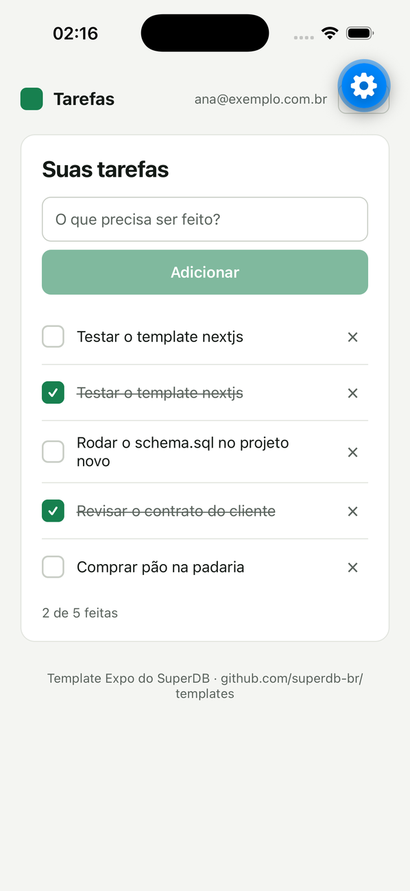

<div align="center">


# Tarefas · Expo + SuperDB

**App de celular com Expo e React Native: login, sessão que sobrevive a fechar o app<br/>e uma lista de tarefas em que cada pessoa só enxerga as próprias.**

    



</div>

## Comece em 3 minutos

**1. Copie o template**

```bash
npx degit superdb-br/templates/expo meu-app
cd meu-app
npm install
```

**2. Ligue ao seu projeto**

```bash
cp .env.example .env
```

Preencha o `.env` com os dados do [painel do SuperDB](https://app.superdb.com.br):

| Variável | O que é | Onde achar |
|---|---|---|
| `EXPO_PUBLIC_SUPERDB_URL` | URL de auth | No SuperDB em nuvem é sempre `https://auth.superdb.com.br` |
| `EXPO_PUBLIC_SUPERDB_ANON_KEY` | A chave pública do projeto | Painel → seu projeto → **Conectar** → *Anon key* |
| `EXPO_PUBLIC_SUPERDB_PROJECT` | O slug do projeto | O que aparece no endereço: `app.superdb.com.br/projects/`**`slug`** |

> [!NOTE]
> A chave anon é pública por natureza: ela vai no código do app. Quem protege os dados é o RLS do `schema.sql`. A **service key** (a outra chave do painel) nunca vai no `.env` de um app.

**3. Crie a tabela**

No painel, abra o projeto → **SQL Editor** → cole o arquivo [`superdb/schema.sql`](./superdb/schema.sql) → rode. Pode rodar de novo quando quiser: nada é duplicado.

```bash
npx expo start
```

Abra o app no celular com o [Expo Go](https://expo.dev/go) (escaneie o QR code) ou no simulador (tecle `i` para iOS, `a` para Android), crie uma conta e adicione a primeira tarefa.

> [!TIP]
> Em desenvolvimento, a tela de login mostra a checagem da conexão: variáveis, projeto e tabela. No build de produção ela não aparece.

> [!IMPORTANT]
> O celular precisa alcançar o seu computador (mesma rede Wi-Fi) para carregar o app no Expo Go. O SuperDB ele alcança pela internet, como qualquer app.

## O que tem aqui

```
expo/
├── superdb/schema.sql            a tabela tarefas + RLS (rode no SQL Editor)
├── index.ts                      a entrada do app
├── src/
│   ├── superdb.ts                o cliente do app, com a sessão no AsyncStorage
│   ├── App.tsx                   qual tela mostrar: configuração, login ou tarefas
│   ├── tema.ts                   as cores, em tema claro e escuro
│   ├── componentes/
│   │   ├── ui.tsx                cartão, botão, campo e mensagem
│   │   ├── Entrar.tsx            login e cadastro
│   │   ├── Tarefas.tsx           a lista: criar, marcar, apagar
│   │   └── Diagnostico.tsx       a checagem da conexão
│   └── lib/superdb/
│       ├── sessao.ts             a sessão que se renova
│       ├── tarefas.ts            as quatro operações de dados
│       ├── erros.ts              códigos do SuperDB → frases em português
│       └── diagnostico.ts        o que a checagem confere
├── AGENTS.md                     regras do SuperDB para agentes de IA
└── .env.example                  as três variáveis
```

## Como funciona

### O cliente, com a sessão guardada no celular

```ts
// src/superdb.ts
import AsyncStorage from '@react-native-async-storage/async-storage'

export const app = criarSuperDB({ url, anonKey, projeto, armazenamento: AsyncStorage })
export const superdb = app.superdb
```

No celular não existe `localStorage`. Sem o `AsyncStorage`, a sessão viveria só na memória e a pessoa teria que entrar de novo a cada vez que abrisse o app.

- **`superdb`** é o cliente do [`@superdb/client`](https://www.npmjs.com/package/@superdb/client), com a mesma API do `supabase-js`.
- **`app`** acrescenta `app.entrar()`, `app.criarConta()`, `app.sair()`, `app.sessao()` e `app.aoMudar(fn)`.

### A sessão se renova sozinha

O token que o login entrega vale **1 hora**, e o SDK ainda não o renova sozinho. O [`sessao.ts`](./src/lib/superdb/sessao.ts) troca o método que o SDK usa para pegar o token de dados (`getDataPlaneToken`) por um que renova quando falta menos de 1 minuto. Quem abre o app depois de horas no bolso não vê erro: a primeira consulta renova e segue.

Várias consultas ao mesmo tempo com o token vencendo fazem **uma** renovação só. Isso importa porque o SuperDB troca o refresh token a cada renovação e trata reuso como roubo: duas renovações simultâneas derrubariam a sessão.

### Quem protege os dados é o banco

O arquivo [`superdb/schema.sql`](./superdb/schema.sql) cria a tabela e liga a regra que faz o trabalho pesado:

```sql
create policy tarefas_do_dono on tarefas
  for all to authenticated
  using (user_id = auth.uid())
  with check (user_id = auth.uid());
```

- **`using`** filtra o que cada pessoa vê. Um `select` sem filtro nenhum devolve só as tarefas de quem pediu.
- **`with check`** recusa gravar uma linha em nome de outra pessoa.
- **`user_id default auth.uid()`**: o banco preenche o dono a partir do token de quem chamou. Por isso o app nunca manda `user_id`, e não adianta forjar um.
- **`revoke all on tarefas from anon`**: a chave anon, que vai no código do app, não lê nada sem login.

> [!IMPORTANT]
> No SuperDB, **toda tabela nova nasce aberta**: a chave anon consegue ler e qualquer usuário logado consegue escrever. Toda tabela que você criar precisa das mesmas linhas do `schema.sql` (RLS ligado, policy, `revoke` da anon e `grant` para `authenticated`). O `AGENTS.md` deste template ensina isso ao seu agente de IA.

### Erros em português, com o próximo passo

O [`erros.ts`](./src/lib/superdb/erros.ts) traduz os códigos do SuperDB em frases para a tela:

| Código | O que a tela diz |
|---|---|
| `invalid_credentials` | E-mail ou senha incorretos. |
| `user_already_exists` | Já existe uma conta com esse e-mail. Tente entrar. |
| `password_breached` | Essa senha aparece em vazamentos conhecidos. Escolha outra. |
| `rate_limited` · `account_locked` | Muitas tentativas. Espere um pouco e tente de novo. |
| `PGRST205` · `42P01` | A tabela "tarefas" ainda não existe neste projeto. Rode o arquivo superdb/schema.sql... |
| `401` · `PGRST301` | Sua sessão expirou. Entre de novo. |
| `PGRST116` | Tarefa não encontrada. Talvez ela já tenha sido apagada. |

Código que o arquivo não conhece aparece com a mensagem original, sem sumir.

## Próximos passos

### Sua própria tabela, no mesmo molde

Rode no SQL Editor (troque `projetos` e as colunas pelo que o seu app precisa):

```sql
create table if not exists projetos (
  id        uuid        primary key default gen_random_uuid(),
  nome      text        not null,
  criado_em timestamptz not null default now(),
  user_id   uuid        not null default auth.uid()
);
alter table projetos enable row level security;
drop policy if exists projetos_do_dono on projetos;
create policy projetos_do_dono on projetos
  for all to authenticated
  using (user_id = auth.uid()) with check (user_id = auth.uid());
revoke all on projetos from anon;
grant select, insert, update, delete on projetos to authenticated;
```

E use no app como as tarefas:

```ts
const { data, error } = await superdb
  .from('projetos')
  .select('id,nome')
  .order('criado_em', { ascending: false })
```

Use `uuid` com `gen_random_uuid()` nos ids, e não `serial`: a sequência de um `serial` não recebe permissão para o usuário logado, e o `insert` falharia.

### Publicar nas lojas

Use o [EAS Build](https://docs.expo.dev/build/introduction/) (`npx eas build`). As variáveis `EXPO_PUBLIC_*` entram no app **na hora do build**: cadastre as três no [EAS](https://docs.expo.dev/eas/environment-variables/) ou no `eas.json` antes de gerar.

## Usando com IA

- O **[`AGENTS.md`](./AGENTS.md)** tem o contrato do SuperDB em uma página: qual token vai onde, como criar tabela com RLS, o que nunca fazer. Claude Code, Cursor, Codex e outros agentes leem sozinhos (o `CLAUDE.md` só aponta para ele).
- Com o **[MCP do SuperDB](https://superdb.com.br/mcp)** conectado, peça *"rode o superdb/schema.sql no meu projeto"* e o agente cria a tabela por você.
- Referência para qualquer IA: [superdb.com.br/llms.txt](https://superdb.com.br/llms.txt).

## Solução de problemas

| O que aparece | Por quê | Como resolver |
|---|---|---|
| "Falta preencher: EXPO_PUBLIC_SUPERDB_…" | O `.env` não existe ou falta uma linha | Copie o `.env.example` para `.env`, preencha e **reinicie** o `npx expo start` |
| "O projeto "x" não existe" | Slug errado | Use o slug que aparece no endereço do projeto no painel: `app.superdb.com.br/projects/`**`slug`** |
| "A tabela "tarefas" ainda não existe" | O `schema.sql` não foi rodado **neste** projeto | SQL Editor → cole `superdb/schema.sql` → rode. Depois, "Conferir de novo" |
| "A API de dados recusou a chave anon" | Chave de outro projeto, ou regenerada no painel | Copie de novo em **Conectar** |
| "A tabela existe, mas aceita consulta sem login" | A tabela foi criada sem o `schema.sql` | Rode o `schema.sql`: ele liga o RLS e fecha a chave anon |
| "Essa senha aparece em vazamentos conhecidos" | O projeto confere senhas contra vazamentos públicos | Escolha outra senha |
| O Expo Go não abre o app | Celular e computador em redes diferentes | Mesma rede Wi-Fi, ou `npx expo start --tunnel` |

## Licença

[MIT](./LICENSE). O código é seu: copie, mude e venda o que construir.

<div align="center">
<sub>Feito pelo <a href="https://superdb.com.br">SuperDB</a> · o backend brasileiro com Postgres, auth e RLS · <a href="https://github.com/superdb-br/templates">todos os templates</a></sub>
</div>
