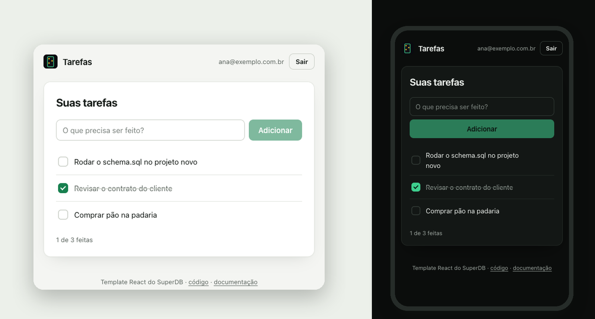

<div align="center">


# Tarefas · HTML puro + SuperDB

**Sem npm, sem build, sem framework: três arquivos e o SDK por CDN.<br/>Login, sessão que se renova sozinha e tarefas protegidas por RLS.**

   



</div>


## Comece em 3 minutos

**1. Copie o template**

```bash
npx degit superdb-br/templates/html meu-app
cd meu-app
```

(Sem Node? Baixe a pasta `html` [daqui](https://github.com/superdb-br/templates) e pronto.)

**2. Ligue ao seu projeto**

Abra o [`config.js`](./config.js) e preencha com os dados do [painel do SuperDB](https://app.superdb.com.br):

```js
export const config = {
  url: 'https://auth.superdb.com.br',  // no SuperDB em nuvem é sempre esta
  anonKey: '',                         // Painel → seu projeto → Conectar → Anon key
  projeto: '',                         // o slug: app.superdb.com.br/projects/<slug>
};
```

> [!NOTE]
> A chave anon é pública por natureza: pode ficar no código publicado. Quem protege os dados é o RLS do `schema.sql`. A **service key** (a outra chave do painel) nunca vai num site.

**3. Crie a tabela**

No painel, abra o projeto → **SQL Editor** → cole o arquivo [`superdb/schema.sql`](./superdb/schema.sql) → rode.

**4. Sirva a pasta**

Os módulos JavaScript não carregam abrindo o arquivo direto (`file://`), então sirva a pasta com qualquer servidor estático:

```bash
npx serve .                  # abre em http://localhost:3000
# ou
python3 -m http.server 8080  # abre em http://localhost:8080
```

Crie uma conta e adicione a primeira tarefa. Enquanto o app roda em `localhost`, a tela de login mostra a checagem da conexão (variáveis, projeto e tabela).

## O que tem aqui

```
html/
├── index.html            a página, e o import map que traz o SDK do esm.sh
├── config.js             os dados do SEU projeto (URL, chave anon, slug)
├── app.js                as três telas (configuração, login, tarefas) em DOM puro
├── js/superdb/
│   ├── sessao.js         a sessão que se renova (e as abas)
│   ├── tarefas.js        as quatro operações de dados
│   ├── erros.js          códigos do SuperDB → frases em português
│   └── diagnostico.js    o que a checagem confere
├── estilo.css            o visual inteiro (troque as cores nas variáveis)
├── superdb/schema.sql    a tabela tarefas + RLS (rode no SQL Editor)
└── AGENTS.md             regras do SuperDB para agentes de IA
```

## Como funciona

### O SDK sem npm

```html
<script type="importmap">
  { "imports": { "@superdb/client": "https://esm.sh/@superdb/client@0.2.2" } }
</script>
```

O import map diz ao navegador de onde vem `@superdb/client`. A versão fica fixa (`@0.2.2`) para o app não mudar sozinho quando sair uma nova. Os arquivos em `js/superdb/` são a mesma lógica que os outros templates usam em TypeScript, já convertida para JavaScript e com os comentários.

### Texto de fora nunca vira HTML

Título de tarefa, e-mail e mensagem de erro entram na página com `textContent`, nunca com `innerHTML`. É o que impede alguém de cadastrar uma tarefa chamada `` e rodar código no navegador de quem abrir a lista. Se você mexer no `app.js`, mantenha a regra.

### A sessão se renova sozinha (e não cai com duas abas)

O token que o login entrega vale **1 hora**, e o SDK ainda não o renova sozinho. Passada a hora, toda consulta voltaria `401` e o app pareceria quebrado. O [`sessao.ts`](./js/superdb/sessao.js) resolve em dois movimentos:

1. **Renova antes de vencer.** O SDK pede o token de dados a um método (`getDataPlaneToken`) antes de cada consulta. O template troca esse método por um que renova quando falta menos de 1 minuto. O resto do app usa `superdb.from(...)` normalmente e nunca pensa nisso.
2. **Uma renovação por vez.** O SuperDB troca o refresh token a cada renovação e trata o uso de um token já trocado como roubo, derrubando a sessão. Duas abas renovando juntas derrubariam o login das duas. Por isso a renovação passa por uma trava entre abas ([Web Locks](https://developer.mozilla.org/docs/Web/API/Web_Locks_API)), e a aba que chega depois adota a sessão que a outra acabou de gravar.

Login e saída numa aba chegam às outras pelo evento `storage` do navegador: sair numa aba tira todas do app.

### Quem protege os dados é o banco

O arquivo [`superdb/schema.sql`](./superdb/schema.sql) cria a tabela e liga a regra que faz o trabalho pesado:

```sql
create policy tarefas_do_dono on tarefas
  for all to authenticated
  using (user_id = auth.uid())
  with check (user_id = auth.uid());
```

- **`using`** filtra o que cada pessoa vê. Um `select` sem filtro nenhum devolve só as tarefas de quem pediu.
- **`with check`** recusa gravar uma linha em nome de outra pessoa.
- **`user_id default auth.uid()`**: o banco preenche o dono a partir do token de quem chamou. Por isso o app nunca manda `user_id`, e não adianta forjar um.
- **`revoke all on tarefas from anon`**: a chave anon, que vai no código do app, não lê nada sem login.

> [!IMPORTANT]
> No SuperDB, **toda tabela nova nasce aberta**: a chave anon consegue ler e qualquer usuário logado consegue escrever. Toda tabela que você criar precisa das mesmas linhas do `schema.sql` (RLS ligado, policy, `revoke` da anon e `grant` para `authenticated`). O `AGENTS.md` deste template ensina isso ao seu agente de IA.

### Erros em português, com o próximo passo

O [`erros.ts`](./js/superdb/erros.js) traduz os códigos do SuperDB em frases para a tela:

| Código | O que a tela diz |
|---|---|
| `invalid_credentials` | E-mail ou senha incorretos. |
| `user_already_exists` | Já existe uma conta com esse e-mail. Tente entrar. |
| `password_breached` | Essa senha aparece em vazamentos conhecidos. Escolha outra. |
| `rate_limited` · `account_locked` | Muitas tentativas. Espere um pouco e tente de novo. |
| `PGRST205` · `42P01` | A tabela "tarefas" ainda não existe neste projeto. Rode o arquivo superdb/schema.sql... |
| `401` · `PGRST301` | Sua sessão expirou. Entre de novo. |
| `PGRST116` | Tarefa não encontrada. Talvez ela já tenha sido apagada. |

Código que o arquivo não conhece aparece com a mensagem original, sem sumir.

## Próximos passos

### Sua própria tabela, no mesmo molde

Rode no SQL Editor (troque `projetos` e as colunas pelo que o seu app precisa):

```sql
create table if not exists projetos (
  id        uuid        primary key default gen_random_uuid(),
  nome      text        not null,
  criado_em timestamptz not null default now(),
  user_id   uuid        not null default auth.uid()
);
alter table projetos enable row level security;
drop policy if exists projetos_do_dono on projetos;
create policy projetos_do_dono on projetos
  for all to authenticated
  using (user_id = auth.uid()) with check (user_id = auth.uid());
revoke all on projetos from anon;
grant select, insert, update, delete on projetos to authenticated;
```

E use no app como as tarefas:

```js
const { data, error } = await superdb
  .from('projetos')
  .select('id,nome')
  .order('criado_em', { ascending: false })
```

Use `uuid` com `gen_random_uuid()` nos ids, e não `serial`: a sequência de um `serial` não recebe permissão para o usuário logado, e o `insert` falharia.

### Publicar

É uma pasta estática: GitHub Pages, Netlify (arraste a pasta), Cloudflare Pages, Vercel ou qualquer nginx servem como está. Não há build.

## Usando com IA

- O **[`AGENTS.md`](./AGENTS.md)** tem o contrato do SuperDB em uma página: qual token vai onde, como criar tabela com RLS, o que nunca fazer. Claude Code, Cursor, Codex e outros agentes leem sozinhos (o `CLAUDE.md` só aponta para ele).
- Com o **[MCP do SuperDB](https://superdb.com.br/mcp)** conectado, peça *"rode o superdb/schema.sql no meu projeto"* e o agente cria a tabela por você.
- Referência para qualquer IA: [superdb.com.br/llms.txt](https://superdb.com.br/llms.txt).

## Solução de problemas

| O que aparece | Por quê | Como resolver |
|---|---|---|
| A página fica em "Carregando…" e o console fala de módulo ou CORS em `file://` | O arquivo foi aberto direto, sem servidor | Sirva a pasta: `npx serve .` |
| "O projeto "x" não existe" | Slug errado | Use o slug que aparece no endereço do projeto no painel: `app.superdb.com.br/projects/`**`slug`** |
| "A tabela "tarefas" ainda não existe" | O `schema.sql` não foi rodado **neste** projeto | SQL Editor → cole `superdb/schema.sql` → rode. Depois, "Conferir de novo" |
| "A API de dados recusou a chave anon" | Chave de outro projeto, ou regenerada no painel | Copie de novo em **Conectar** |
| "A tabela existe, mas aceita consulta sem login" | A tabela foi criada sem o `schema.sql` | Rode o `schema.sql`: ele liga o RLS e fecha a chave anon |
| "Essa senha aparece em vazamentos conhecidos" | O projeto confere senhas contra vazamentos públicos | Escolha outra senha |
| Dois `401` no console, na tela de login | É a checagem da conexão perguntando sem login, de propósito | Nada. Fora de `localhost` ela não roda |

## Licença

[MIT](./LICENSE). O código é seu: copie, mude e venda o que construir.

<div align="center">
<sub>Feito pelo <a href="https://superdb.com.br">SuperDB</a> · o backend brasileiro com Postgres, auth e RLS · <a href="https://github.com/superdb-br/templates">todos os templates</a></sub>
</div>
