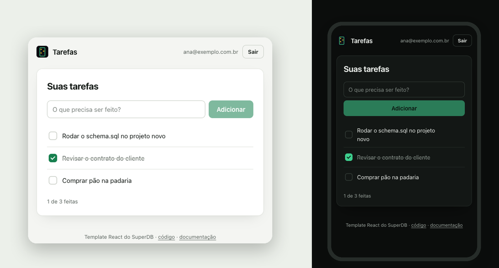
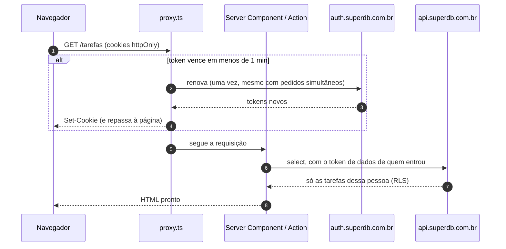

<div align="center">


# Tarefas · Next.js + SuperDB

**App Router com Server Components e Server Actions: a sessão fica em cookies httpOnly,<br/>se renova sozinha no proxy, e cada pessoa só enxerga as próprias tarefas.**

    



</div>

## Comece em 3 minutos

**1. Copie o template**

```bash
npx create-next-app@latest meu-app --example https://github.com/superdb-br/templates/tree/main/nextjs
cd meu-app
```

**2. Ligue ao seu projeto**

```bash
cp .env.example .env.local
```

Preencha o `.env.local` com os dados do [painel do SuperDB](https://app.superdb.com.br):

| Variável | O que é | Onde achar |
|---|---|---|
| `NEXT_PUBLIC_SUPERDB_URL` | URL de auth | No SuperDB em nuvem é sempre `https://auth.superdb.com.br` |
| `NEXT_PUBLIC_SUPERDB_ANON_KEY` | A chave pública do projeto | Painel → seu projeto → **Conectar** → *Anon key* |
| `NEXT_PUBLIC_SUPERDB_PROJECT` | O slug do projeto | O que aparece no endereço: `app.superdb.com.br/projects/`**`slug`** |

> [!NOTE]
> A chave anon é pública por natureza: ela vai no código do app. Quem protege os dados é o RLS do `schema.sql`. A **service key** (a outra chave do painel) nunca vai no `.env.local` de um app.

**3. Crie a tabela**

No painel, abra o projeto → **SQL Editor** → cole o arquivo [`superdb/schema.sql`](./superdb/schema.sql) → rode. Pode rodar de novo quando quiser: nada é duplicado.

```bash
npm run dev
```

Abra [localhost:3000](http://localhost:3000), crie uma conta e adicione a primeira tarefa.

> [!TIP]
> Em `npm run dev`, a página inicial mostra a checagem da conexão, feita no servidor: variáveis, projeto e tabela. Em produção ela só aparece se faltar configurar algo.

## O que tem aqui

```
nextjs/
├── superdb/schema.sql              a tabela tarefas + RLS (rode no SQL Editor)
├── proxy.ts                        renova a sessão antes de cada página e Server Action
├── app/
│   ├── page.tsx                    login + checagem da conexão (vai para /tarefas se já entrou)
│   ├── FormularioEntrar.tsx        o formulário (client), que chama a Server Action
│   ├── acoes.ts                    Server Actions: entrar, criar conta, sair
│   ├── Cabecalho.tsx               a marca, o e-mail e o botão de sair
│   ├── tarefas/
│   │   ├── page.tsx                a lista, buscada NO SERVIDOR com o token de quem entrou
│   │   ├── ListaDeTarefas.tsx      os cliques, com resposta imediata (useOptimistic)
│   │   └── acoes.ts                Server Actions: adicionar, alternar, apagar
│   └── estilo.css                  o visual inteiro (troque as cores nas variáveis)
├── lib/superdb/
│   ├── servidor.ts                 superdbDoServidor(): o cliente de cada requisição
│   ├── cookies.ts                  a sessão guardada em quatro cookies httpOnly
│   ├── renovar.ts                  a renovação usada pelo proxy (uma por vez)
│   ├── config.ts                   as três variáveis
│   ├── tarefas.ts                  as quatro operações de dados
│   ├── erros.ts                    códigos do SuperDB → frases em português
│   └── diagnostico.ts              o que a checagem confere
├── AGENTS.md                       regras do SuperDB para agentes de IA
└── .env.example                    as três variáveis
```

## Como funciona



### A sessão mora em cookies httpOnly

No Next, quem busca os dados é o servidor. O servidor não enxerga o `localStorage` do navegador, mas recebe os cookies em toda requisição. E, sendo `httpOnly`, nenhum JavaScript da página (nem um script injetado) consegue ler os tokens.

São **quatro cookies** (`sdb-acesso`, `sdb-renovacao`, `sdb-dados`, `sdb-vence`), e não um: a sessão inteira em JSON passaria de 4 KB, o limite de um cookie. O [`cookies.ts`](./lib/superdb/cookies.ts) é o adaptador: o SDK acha que está falando com um armazenamento qualquer, e as leituras e gravações viram cookies.

### Um cliente por requisição

```ts
// Em Server Components, Server Actions e Route Handlers:
const superdb = await superdbDoServidor()
const { data, error } = await superdb.from('tarefas').select('id,titulo')
```

> [!CAUTION]
> Nunca guarde o cliente numa variável de módulo (`const superdb = ...` fora de uma função). No servidor, ela seria compartilhada entre visitantes, e um veria os dados do outro.

### A renovação acontece no proxy, uma vez só

O token vale **1 hora**. O [`proxy.ts`](./proxy.ts) (o antigo `middleware.ts`, renomeado no Next 16) roda antes de cada página e de cada Server Action, e é o único lugar em que dá para regravar cookies antes de a página ler. Quando falta menos de 1 minuto, ele renova.

A armadilha: o SuperDB troca o refresh token a cada renovação e trata o uso de um token já trocado como roubo, derrubando a sessão. Uma página dispara várias requisições quase juntas (a página, os prefetches, uma Server Action), todas com o mesmo cookie. Por isso o [`renovar.ts`](./lib/superdb/renovar.ts):

- faz **uma** renovação por refresh token, e as requisições simultâneas esperam por ela;
- por **30 segundos**, entrega a sessão já renovada a quem chegar com o token antigo (o navegador ainda não tinha recebido o cookie novo).

Testado com seis requisições simultâneas e o token vencendo: uma renovação, nenhuma sessão derrubada.

> [!NOTE]
> Essa proteção vive na memória do servidor. Com várias instâncias ao mesmo tempo (serverless com muito tráfego), cada uma tem a sua, e sobra uma janela pequena para duas renovarem juntas. Num servidor só (`next start`, Docker, Coolify), não sobra.

### Quem protege é a página e a ação, não o proxy

O proxy só renova. A página [`/tarefas`](./app/tarefas/page.tsx) confere a sessão e manda para o login se não houver ninguém; cada Server Action confere de novo antes de agir. Server Actions são endpoints públicos: qualquer um pode chamá-las com qualquer `id`. E mesmo assim o banco confere pela terceira vez:

### Quem protege os dados é o banco

O arquivo [`superdb/schema.sql`](./superdb/schema.sql) cria a tabela e liga a regra que faz o trabalho pesado:

```sql
create policy tarefas_do_dono on tarefas
  for all to authenticated
  using (user_id = auth.uid())
  with check (user_id = auth.uid());
```

- **`using`** filtra o que cada pessoa vê. Um `select` sem filtro nenhum devolve só as tarefas de quem pediu.
- **`with check`** recusa gravar uma linha em nome de outra pessoa.
- **`user_id default auth.uid()`**: o banco preenche o dono a partir do token de quem chamou. Por isso o app nunca manda `user_id`, e não adianta forjar um.
- **`revoke all on tarefas from anon`**: a chave anon, que vai no código do app, não lê nada sem login.

> [!IMPORTANT]
> No SuperDB, **toda tabela nova nasce aberta**: a chave anon consegue ler e qualquer usuário logado consegue escrever. Toda tabela que você criar precisa das mesmas linhas do `schema.sql` (RLS ligado, policy, `revoke` da anon e `grant` para `authenticated`). O `AGENTS.md` deste template ensina isso ao seu agente de IA.

### Erros em português, com o próximo passo

O [`erros.ts`](./lib/superdb/erros.ts) traduz os códigos do SuperDB em frases para a tela:

| Código | O que a tela diz |
|---|---|
| `invalid_credentials` | E-mail ou senha incorretos. |
| `user_already_exists` | Já existe uma conta com esse e-mail. Tente entrar. |
| `password_breached` | Essa senha aparece em vazamentos conhecidos. Escolha outra. |
| `rate_limited` · `account_locked` | Muitas tentativas. Espere um pouco e tente de novo. |
| `PGRST205` · `42P01` | A tabela "tarefas" ainda não existe neste projeto. Rode o arquivo superdb/schema.sql... |
| `401` · `PGRST301` | Sua sessão expirou. Entre de novo. |
| `PGRST116` | Tarefa não encontrada. Talvez ela já tenha sido apagada. |

Código que o arquivo não conhece aparece com a mensagem original, sem sumir.

## Próximos passos

### Sua própria tabela, no mesmo molde

Rode no SQL Editor (troque `projetos` e as colunas pelo que o seu app precisa):

```sql
create table if not exists projetos (
  id        uuid        primary key default gen_random_uuid(),
  nome      text        not null,
  criado_em timestamptz not null default now(),
  user_id   uuid        not null default auth.uid()
);
alter table projetos enable row level security;
drop policy if exists projetos_do_dono on projetos;
create policy projetos_do_dono on projetos
  for all to authenticated
  using (user_id = auth.uid()) with check (user_id = auth.uid());
revoke all on projetos from anon;
grant select, insert, update, delete on projetos to authenticated;
```

E use no app como as tarefas, sempre com o cliente da requisição:

```ts
// app/projetos/page.tsx (Server Component)
const superdb = await superdbDoServidor()
const { data, error } = await superdb
  .from('projetos')
  .select('id,nome')
  .order('criado_em', { ascending: false })
```

Use `uuid` com `gen_random_uuid()` nos ids, e não `serial`: a sequência de um `serial` não recebe permissão para o usuário logado, e o `insert` falharia.

### Publicar

- **Vercel:** importe o repositório e cadastre as três variáveis `NEXT_PUBLIC_SUPERDB_*` antes do primeiro deploy.
- **Docker, Coolify, VPS:** `npm run build && npm start`. Cadastre as variáveis antes do build.

> [!WARNING]
> Variáveis `NEXT_PUBLIC_*` entram no código **na hora do build**. Trocou alguma? Refaça o build.

## Usando com IA

- O **[`AGENTS.md`](./AGENTS.md)** tem o contrato do SuperDB em uma página: qual token vai onde, como criar tabela com RLS, o que nunca fazer. Claude Code, Cursor, Codex e outros agentes leem sozinhos (o `CLAUDE.md` só aponta para ele).
- Com o **[MCP do SuperDB](https://superdb.com.br/mcp)** conectado, peça *"rode o superdb/schema.sql no meu projeto"* e o agente cria a tabela por você.
- Referência para qualquer IA: [superdb.com.br/llms.txt](https://superdb.com.br/llms.txt).

## Solução de problemas

| O que aparece | Por quê | Como resolver |
|---|---|---|
| "Falta preencher: NEXT_PUBLIC_SUPERDB_…" | O `.env.local` não existe ou falta uma linha | Copie o `.env.example` para `.env.local`, preencha e **reinicie** o `npm run dev` |
| "O projeto "x" não existe" | Slug errado | Use o slug que aparece no endereço do projeto no painel: `app.superdb.com.br/projects/`**`slug`** |
| "A tabela "tarefas" ainda não existe" | O `schema.sql` não foi rodado **neste** projeto | SQL Editor → cole `superdb/schema.sql` → rode. Depois, "Conferir de novo" |
| "A API de dados recusou a chave anon" | Chave de outro projeto, ou regenerada no painel | Copie de novo em **Conectar** |
| "A tabela existe, mas aceita consulta sem login" | A tabela foi criada sem o `schema.sql` | Rode o `schema.sql`: ele liga o RLS e fecha a chave anon |
| "Essa senha aparece em vazamentos conhecidos" | O projeto confere senhas contra vazamentos públicos | Escolha outra senha |
| "Sua sessão expirou" | O SuperDB não respondeu na hora de renovar, ou a sessão foi encerrada em outro lugar | "Entrar de novo" limpa os cookies e volta ao login |

## Licença

[MIT](./LICENSE). O código é seu: copie, mude e venda o que construir.

<div align="center">
<sub>Feito pelo <a href="https://superdb.com.br">SuperDB</a> · o backend brasileiro com Postgres, auth e RLS · <a href="https://github.com/superdb-br/templates">todos os templates</a></sub>
</div>
