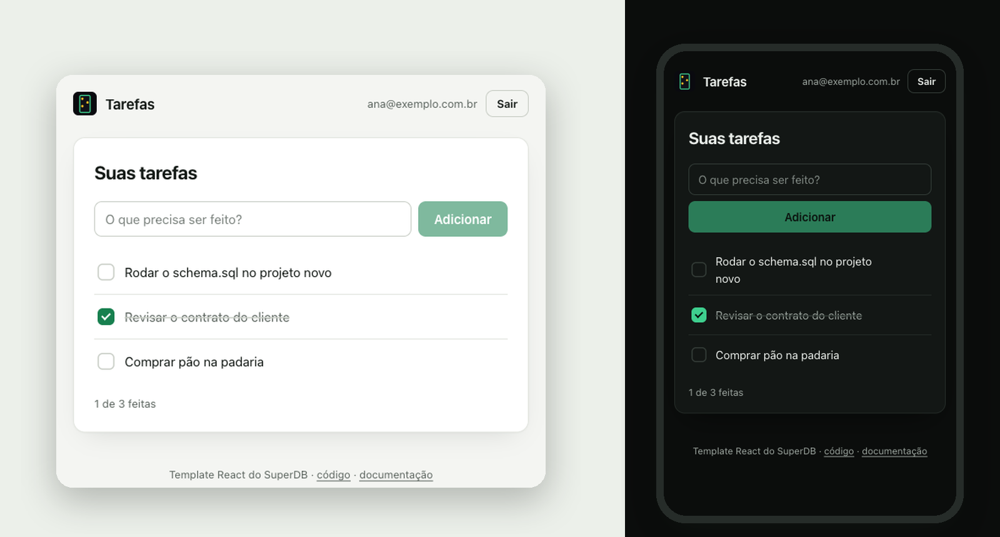

<div align="center">


# Tarefas · SvelteKit + SuperDB

**SPA estática com Svelte 5 e SvelteKit: login, sessão que se renova sozinha<br/>e uma lista de tarefas em que cada pessoa só enxerga as próprias.**

    



</div>

## Comece em 3 minutos

**1. Copie o template**

```bash
npx degit superdb-br/templates/sveltekit meu-app
cd meu-app
npm install
```

**2. Ligue ao seu projeto**

```bash
cp .env.example .env
```

Preencha o `.env` com os dados do [painel do SuperDB](https://app.superdb.com.br):

| Variável | O que é | Onde achar |
|---|---|---|
| `VITE_SUPERDB_URL` | URL de auth | No SuperDB em nuvem é sempre `https://auth.superdb.com.br` |
| `VITE_SUPERDB_ANON_KEY` | A chave pública do projeto | Painel → seu projeto → **Conectar** → *Anon key* |
| `VITE_SUPERDB_PROJECT` | O slug do projeto | O que aparece no endereço: `app.superdb.com.br/projects/`**`slug`** |

> [!NOTE]
> A chave anon é pública por natureza: ela vai no código do app. Quem protege os dados é o RLS do `schema.sql`. A **service key** (a outra chave do painel) nunca vai no `.env` de um app.

**3. Crie a tabela**

No painel, abra o projeto → **SQL Editor** → cole o arquivo [`superdb/schema.sql`](./superdb/schema.sql) → rode. Pode rodar de novo quando quiser: nada é duplicado.

```bash
npm run dev
```

Abra [localhost:5173](http://localhost:5173), crie uma conta e adicione a primeira tarefa.

> [!TIP]
> Em `npm run dev`, a tela de login mostra a checagem da conexão: variáveis, projeto e tabela. No build de produção ela não aparece.

## O que tem aqui

```
sveltekit/
├── superdb/schema.sql              a tabela tarefas + RLS (rode no SQL Editor)
├── src/
│   ├── routes/
│   │   ├── +layout.ts              ssr = false: tudo roda no navegador
│   │   └── +page.svelte            qual tela mostrar: configuração, login ou tarefas
│   ├── lib/
│   │   ├── superdb.ts              o cliente do app: importe de `$lib/superdb`
│   │   ├── sessao.svelte.ts        a sessão como estado reativo ($state)
│   │   ├── componentes/            Entrar, Tarefas e Diagnostico (.svelte)
│   │   └── superdb/
│   │       ├── sessao.ts           a sessão que se renova (e as abas)
│   │       ├── tarefas.ts          as quatro operações de dados
│   │       ├── erros.ts            códigos do SuperDB → frases em português
│   │       └── diagnostico.ts      o que a checagem confere
│   └── estilo.css                  o visual inteiro (troque as cores nas variáveis)
├── vite.config.ts                  adapter-static com fallback: vira arquivos estáticos
├── AGENTS.md                       regras do SuperDB para agentes de IA
└── .env.example                    as três variáveis
```

## Como funciona

### Por que SPA, e por que `VITE_`

A sessão vive no `localStorage`, que só existe no navegador. Por isso o `+layout.ts` desliga o SSR, e o `adapter-static` transforma o app em arquivos estáticos: não há servidor Node para manter. Se você precisa de SSR com a sessão no servidor, veja o [template Next.js](../nextjs), que guarda a sessão em cookies.

As variáveis vêm de `import.meta.env.VITE_*` e não de `$env/static/public` de propósito: com `$env/static`, esquecer o `.env` quebraria o build; assim o app sobe e a tela de configuração diz o que falta.

### O cliente e a sessão reativa

```ts
import { superdb, app } from '$lib/superdb'
import { sessaoAtual } from '$lib/sessao.svelte'   // sessaoAtual.sessao muda sozinha
```

- **`superdb`** é o cliente do [`@superdb/client`](https://www.npmjs.com/package/@superdb/client), com a mesma API do `supabase-js`.
- **`app`** acrescenta `app.entrar()`, `app.criarConta()`, `app.sair()`, `app.sessao()` e `app.aoMudar(fn)`.

### A sessão se renova sozinha (e não cai com duas abas)

O token que o login entrega vale **1 hora**, e o SDK ainda não o renova sozinho. Passada a hora, toda consulta voltaria `401` e o app pareceria quebrado. O [`sessao.ts`](./src/lib/superdb/sessao.ts) resolve em dois movimentos:

1. **Renova antes de vencer.** O SDK pede o token de dados a um método (`getDataPlaneToken`) antes de cada consulta. O template troca esse método por um que renova quando falta menos de 1 minuto. O resto do app usa `superdb.from(...)` normalmente e nunca pensa nisso.
2. **Uma renovação por vez.** O SuperDB troca o refresh token a cada renovação e trata o uso de um token já trocado como roubo, derrubando a sessão. Duas abas renovando juntas derrubariam o login das duas. Por isso a renovação passa por uma trava entre abas ([Web Locks](https://developer.mozilla.org/docs/Web/API/Web_Locks_API)), e a aba que chega depois adota a sessão que a outra acabou de gravar.

Login e saída numa aba chegam às outras pelo evento `storage` do navegador: sair numa aba tira todas do app.

### Quem protege os dados é o banco

O arquivo [`superdb/schema.sql`](./superdb/schema.sql) cria a tabela e liga a regra que faz o trabalho pesado:

```sql
create policy tarefas_do_dono on tarefas
  for all to authenticated
  using (user_id = auth.uid())
  with check (user_id = auth.uid());
```

- **`using`** filtra o que cada pessoa vê. Um `select` sem filtro nenhum devolve só as tarefas de quem pediu.
- **`with check`** recusa gravar uma linha em nome de outra pessoa.
- **`user_id default auth.uid()`**: o banco preenche o dono a partir do token de quem chamou. Por isso o app nunca manda `user_id`, e não adianta forjar um.
- **`revoke all on tarefas from anon`**: a chave anon vai no código do app. Sem permissão nenhuma na tabela, ela continua sem ler mesmo que alguém crie depois uma policy aberta demais.

> [!IMPORTANT]
> No SuperDB, **toda tabela nova nasce fechada**: o RLS vem ligado e sem nenhuma policy, então o app não lê nem grava nada nela até você escrever as policies. Lista sempre vazia, sem erro, quase sempre é isso. Toda tabela que você criar precisa das mesmas linhas do `schema.sql` (policy, `revoke` da anon e `grant` para `authenticated`). O `AGENTS.md` deste template ensina isso ao seu agente de IA.

### Erros em português, com o próximo passo

O [`erros.ts`](./src/lib/superdb/erros.ts) traduz os códigos do SuperDB em frases para a tela:

| Código | O que a tela diz |
|---|---|
| `invalid_credentials` | E-mail ou senha incorretos. |
| `user_already_exists` | Já existe uma conta com esse e-mail. Tente entrar. |
| `password_breached` | Essa senha aparece em vazamentos conhecidos. Escolha outra. |
| `rate_limited` · `account_locked` | Muitas tentativas. Espere um pouco e tente de novo. |
| `PGRST205` · `42P01` | A tabela "tarefas" ainda não existe neste projeto. Rode o arquivo superdb/schema.sql... |
| `401` · `PGRST301` | Sua sessão expirou. Entre de novo. |
| `PGRST116` | Tarefa não encontrada. Talvez ela já tenha sido apagada. |

Código que o arquivo não conhece aparece com a mensagem original, sem sumir.

## Próximos passos

### Sua própria tabela, no mesmo molde

Rode no SQL Editor (troque `projetos` e as colunas pelo que o seu app precisa):

```sql
create table if not exists projetos (
  id        uuid        primary key default gen_random_uuid(),
  nome      text        not null,
  criado_em timestamptz not null default now(),
  user_id   uuid        not null default auth.uid()
);
alter table projetos enable row level security;
drop policy if exists projetos_do_dono on projetos;
create policy projetos_do_dono on projetos
  for all to authenticated
  using (user_id = auth.uid()) with check (user_id = auth.uid());
revoke all on projetos from anon;
grant select, insert, update, delete on projetos to authenticated;
```

E use no app como as tarefas:

```ts
const { data, error } = await superdb
  .from('projetos')
  .select('id,nome')
  .order('criado_em', { ascending: false })
```

Use `uuid` com `gen_random_uuid()` nos ids: um id sequencial entrega quantas linhas a tabela tem e deixa adivinhar o id das linhas dos outros.

### Publicar

`npm run build` gera a pasta `build/`: arquivos estáticos que qualquer hospedagem serve (Vercel, Netlify, Cloudflare Pages, GitHub Pages, nginx).

> [!WARNING]
> As variáveis `VITE_*` entram no código **na hora do build**. Cadastre as três na hospedagem antes do build, e refaça o build se trocar alguma.

Como é um app de página única, a hospedagem precisa responder `index.html` em qualquer caminho (Vercel e Netlify já fazem isso para projetos Vite).

## Usando com IA

- O **[`AGENTS.md`](./AGENTS.md)** tem o contrato do SuperDB em uma página: qual token vai onde, como criar tabela com RLS, o que nunca fazer. Claude Code, Cursor, Codex e outros agentes leem sozinhos (o `CLAUDE.md` só aponta para ele).
- Com o **[MCP do SuperDB](https://superdb.com.br/mcp)** conectado, peça *"rode o superdb/schema.sql no meu projeto"* e o agente cria a tabela por você.
- Referência para qualquer IA: [superdb.com.br/llms.txt](https://superdb.com.br/llms.txt).

## Solução de problemas

| O que aparece | Por quê | Como resolver |
|---|---|---|
| "Falta preencher: VITE_SUPERDB_…" | O `.env` não existe ou falta uma linha | Copie o `.env.example` para `.env`, preencha e **reinicie** o `npm run dev`: o Vite só lê o `.env` ao iniciar |
| "O projeto "x" não existe" | Slug errado | Use o slug que aparece no endereço do projeto no painel: `app.superdb.com.br/projects/`**`slug`** |
| "A tabela "tarefas" ainda não existe" | O `schema.sql` não foi rodado **neste** projeto | SQL Editor → cole `superdb/schema.sql` → rode. Depois, "Conferir de novo" |
| "A API de dados recusou a chave anon" | Chave de outro projeto, ou regenerada no painel | Copie de novo em **Conectar** |
| "A chave anon ainda tem acesso à tabela" | O `schema.sql` não rodou (ou não rodou inteiro) neste projeto | Rode o `schema.sql` de novo: ele cria a policy de cada dono e fecha a chave anon |
| "Essa senha aparece em vazamentos conhecidos" | O projeto confere senhas contra vazamentos públicos | Escolha outra senha |
| Dois `401` no console, na tela de login | É a checagem da conexão perguntando sem login, de propósito | Nada. Ela só roda em `npm run dev` |

## Licença

[MIT](./LICENSE). O código é seu: copie, mude e venda o que construir.

<div align="center">
<sub>Feito pelo <a href="https://superdb.com.br">SuperDB</a> · o backend brasileiro com Postgres, auth e RLS · <a href="https://github.com/superdb-br/templates">todos os templates</a></sub>
</div>
